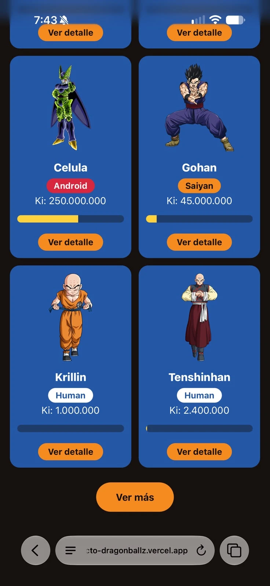

# Mi proyecto Dragon Ball

> Completa este archivo **con tus propias palabras**, sin pegar texto generado por una IA. Las respuestas de análisis son de un párrafo como mínimo cada una. Puedes usar el botón «Copiar mis respuestas (Markdown)» del enunciado para pegar aquí las partes A y D.

**Estudiante:** Andrés Giraldo Zuluaga
**Fecha:** 18/10/2026

## Cómo ejecutar mi proyecto

```bash
npm install
npm run build
npm run servir
```

Abre `http://localhost:5500/04-proyecto/dragonball/nivel7/`.

## Mi página publicada (bonus, nivel 8)

URL de Vercel: https://proyecto-dragonballz.vercel.app
Captura abierta en mi celular:



---

## A · Exploración de la API

_(Pega aquí tu tabla comparativa PokéAPI vs Dragon Ball y tus respuestas.)_

## B · Diseño

- **Herramienta usada:** _Claude Design / Google Stitch_
- **Mi prompt:** _…_
- **Iteración (qué pedí cambiar y por qué):** _…_
- **Uso de cada color de la paleta:** _…_
- **Capturas:** web (listado y detalle) y móvil (listado y detalle).

## C · Decisiones y bitácora de errores

- **¿Necesité `Promise.all`? ¿Por qué?** _…_
- **¿Cómo traté el `ki` (viene como texto)?** _…_
- **¿Busqué con la API o filtré en el cliente? ¿Por qué?** _…_

| Error que me salió | Causa | Cómo lo resolví |
|---|---|---|
| _…_ | _…_ | _…_ |

## Mis comandos de Git

Explica cada comando **con tus palabras**: qué hace y cuándo lo usaste en este proyecto.

| Comando | Qué hace (con mis palabras) | Cuándo lo usé |
|---|---|---|
| `git status` | _…_ | _…_ |
| `git checkout -b nivel-1` | _…_ | _…_ |
| `git checkout nivel-1` | _…_ | _…_ |
| `git add .` | _…_ | _…_ |
| `git commit -m "…"` | _…_ | _…_ |
| `git push -u origin nivel-1` | _…_ | _…_ |
| `git pull` | _…_ | _…_ |

**Mi repositorio de GitHub (público):** https://github.com/andrezg87/proyecto-dragonballz
**Mis ramas:** `nivel-1`, `nivel-2`, `nivel-3`, `nivel-4`, `nivel-5`, `nivel-6`, `nivel-7` y `nivel-8` (la que publica Vercel)

## Bitácora de conversación con la IA

Al menos **3 momentos** en que cuestioné o corregí a la IA. Cuéntalo con tus palabras.

| Qué le pedí | Qué hizo mal o qué no entendí | Cómo lo corregí o qué aprendí |
|---|---|---|
| _…_ | _…_ | _…_ |

## ★ Bonus planetas (si lo hice)

- **Prompt e iteración del diseño de planetas:** _…_
- **Capturas:** planetas web y móvil (listado y detalle).
- **¿Qué reutilicé de los personajes y qué tuve que cambiar?** _…_

## D · Análisis de mi código

### Preguntas abiertas

_(Pega aquí tus 8 respuestas.)_

### Selección múltiple

_(Pega aquí tus 4 respuestas.)_
